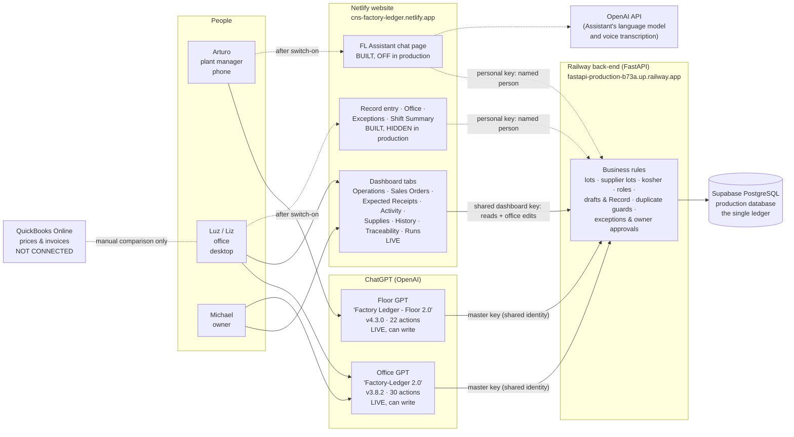
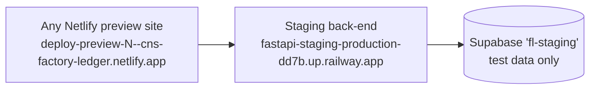

# B. Architecture: the parts of Factory Ledger and how they connect

Status words used throughout:

- **Live**: working in production, checked on 2026-10-28.
- **Built, off**: the code is in production, but its switch is off.
- **Staging only**: on, but only in the test copy.
- **Planned**: exists only in documents or unmerged branches.
- **Unverified**: could not be checked.

## Diagram

Read the arrows like this:

- **Solid arrows** are in use today.
- **Dashed arrows** are built but switched off in production.
- **Every path ends at the same back end and the same database.** There is no second copy of the inventory anywhere.

The test copy (staging) has the same shape, but it is a separate back end and database, filled with test data:

## Component by component

### 1. Production database (Supabase / PostgreSQL)

- **Purpose:** the one permanent record of everything.
- **Stores:**
  - products, recipes, suppliers, customers;
  - every lot with its supplier lot code;
  - every transaction (receive, make, pack, ship, adjust, found, void corrections), with who entered it and when;
  - sales orders and shipments;
  - expected receipts;
  - exceptions (open problems) and approvals;
  - photos (BOLs, lot tags, signed slips);
  - draft "tickets" waiting for Record.
- **Who enters data here:** nobody directly. All changes go through the back end. Direct database access is for engineering, read-only.
- **Talks to:** only the back end.
- **Status:** **Live**, Supabase project *MyFirstProject* (us-east-1).
- **Staging:** a separate Supabase project, *fl-staging*. A safety check stops the staging server starting if it is ever pointed at the production database.
- **What it showed on 2026-10-28:**
  - 4 accounts: Blubber (owner), Arturo (floor), Luz (office), Miriam (office).
  - 13 open sales orders.
  - 2 open expected receipts.
  - 2 open "unidentified supplier lot" exceptions.
  - 0 production-schedule rows.

### 2. Back-end server (Railway, FastAPI)

- **Purpose:** the brain. Every interface sends its requests here. This is where the rules live:
  - supplier lot required on receiving (or an explicit "no lot on label");
  - kosher tiers;
  - no shipping more than is on hand;
  - shortages and unidentified lots opening exceptions;
  - corrections over 500 lb needing a photo or owner approval;
  - roles (floor, office, owner);
  - the "draft, then Record" step;
  - duplicate-shipment protection.
- **Stores:** nothing itself; it reads and writes the database.
- **Data entry:** it accepts entries from every interface.
- **Talks to:** the database, OpenAI (only for the FL Assistant), and the Supabase file store for photos.
- **Status:** **Live**, healthy, deployment `9a01f022` (2026-10-28 12:39 ET, GitHub `main` `9a9a9536`).
- **URL:** `https://fastapi-production-b73a.up.railway.app`. People never visit this directly.
- **Staging:** `https://fastapi-staging-production-dd7b.up.railway.app` (Railway service *FastAPI-staging*).
- **How it gets updated:** every merge to `main` on GitHub deploys it automatically.

**Production switches that matter for staff** (as reported by the server on 2026-10-28):

| Switch | Production | Staging | Effect when off |
|---|---|---|---|
| Personal sign-in (key sessions) | **Off** | On | Dashboard hides Record entry, Office and Exceptions; no "sign in once per shift" |
| FL Assistant | **Off** | On | Every Assistant request is refused |
| Read-only GPT key | **Not set** | n/a | GPTs can only run on the full master key |
| PIN sign-in | Not built on `main` (branch only, PR #96) | Off | Staff must paste a long personal key |

### 3. Dashboard (Netlify website)

- **Purpose:** the place to **see** everything, and, once switched on, a set of simple **forms** for entries and office work.
- **Shows:**
  - "Needs Attention" alerts and the "Today so far" production tile;
  - stock on hand by product and lot, the production calendar and ledger health checks;
  - sales orders (with tabs Open, Ready to ship, Overdue, Shipped, Closed, Cancelled);
  - expected receipts, supplies, daily activity, ledger history;
  - lot traceability and material-flow charts;
  - production runs.
- **Can users enter data?**
  - **Today, in production, through the main tabs:** new sales orders from a customer PO photo or PDF, order and line edits, close, cancel and reopen, set-aside stock, mark ready, expected receipts (including from a supplier document), production runs, notes and supply requests. **All of these are saved under a shared dashboard identity, not a person.**
  - **After personal sign-in is switched on:**
    - **Record entry** (receive, make, pack, ship, adjust, found);
    - **Office** (orders, customers, expected receipts, approving extracted documents);
    - **Exceptions** (resolve, approve, reject);
    - **Receipt** page (void an entry);
    - **Shift Summary** (confirm the day).
    - Each of these records the named person, and the main tabs' edit buttons then route to the Office screen.
- **Talks to:** the back end directly from the browser. Netlify only hosts the pages.
- **Who:** everyone. It is primary for Luz and Michael.
- **Status:** **Live.** Pages load; reads work. The entry, office and exceptions screens are **built, hidden** in production.
- **URL:** `https://cns-factory-ledger.netlify.app`.
- **Staging:** any other Netlify address, for example `deploy-preview-<number>--cns-factory-ledger.netlify.app`, automatically talks to the **staging** back end. **No banner on the page shows which one you are on.**

### 4. FL Assistant (web chat)

- **Purpose:** a phone-friendly chat in Spanish or English.
  - The worker types or holds-to-talk ("received 40 cases of oats from Quali Pack, BOL 12345, lot 26-0915").
  - The Assistant asks for anything missing and builds a **draft**, which Factory Ledger itself checks.
  - The worker ticks any warnings, types the lot-tag codes, and presses **Record**. Nothing is recorded before that.
- **What it can do:**
  - **Record:** receive, make (granola and coconut are both "make"), pack, ship (against an order, standalone or bulk) with BOL and photos, adjust, Found, and create a customer or sales order (office and owner only).
  - **Look up:** inventory, lots, open orders, today's entries and receipts.
  - **Hands off:** voids, order changes and expected receipts go to the right dashboard screen, via a link.
  - **Cannot do:** counts, exceptions, schedule, end-of-day confirmation. It also cannot read supplier paperwork from a photo; photos are only attached as evidence.
- **Talks to:** the same back end. It uses the same "draft, then Record" system as the dashboard forms, and OpenAI for language and voice.
- **Who:** designed for Arturo and the floor; office can use it for quick orders.
- **Status:** **Built, off in production.** Production refuses with "FL Assistant is not enabled" and has 0 Assistant sessions ever. It is **on in staging**, where it went through five fix rounds (A to E, October 15 to 16) driven by phone testing. Final validation ran against local copies of staging data, **not on a physical phone microphone and not in production**.
- **URL once on:** `https://cns-factory-ledger.netlify.app/fl-assistant.html`. It is reached from the "FL" link on the Record entry and Office screens and is **not in the main menu**.
- **Staging:** a Netlify preview address, `/fl-assistant.html`.
- **Unverified:** whether a production OpenAI key with a spending cap is in place. FOLLOWUPS P1.18 asks for a separate key with a $20/month cap, and for the old proof-of-concept key to be revoked before Nov 6.

### 5. Floor GPT ("Factory Ledger - Floor 2.0" in ChatGPT)

- **Purpose:** chat for floor work inside ChatGPT.
- **Can do:**
  - **Record:** receive, make, pack, ship, adjust, void, rename a lot, fix a supplier lot code, change order status, preview a shipment against an order and then commit it.
  - Commit returns a **10-minute packing-slip link** (live since Oct 28, **not yet seen on a real shipment**).
  - **Look up:** products, recipes, inventory, lots by FL or supplier code, trace by supplier lot, transaction history, day summary, orders.
- **Cannot do:**
  - **Found inventory:** its instructions mention Found, but there is no Found action.
  - Create or edit orders, customers or expected receipts; counts; exceptions; schedule.
- **Talks to:** the production back end, with the **master key**. Every entry is recorded as "legacy-shared-key"; no person is named.
- **Who:** Arturo, **interim only**.
- **Status:** **Live, can write.** v4.3.0 was pasted Oct 21 (per `FREEZE-LIFT-PLAN.md`). The GPT editor itself was not inspected (**Unverified** beyond that record).
- **URL:** a chatgpt.com link (not recorded in the repo; **Unverified**).
- **Staging:** none. The GPTs only point at production.

### 6. Office GPT ("Factory-Ledger 2.0" in ChatGPT)

- **Purpose:** chat for office work.
- **Can do:**
  - **Record:** receive, make, pack, ship (standalone and against an order, preview then commit), adjust, fix a supplier lot code;
  - create and edit customers; create and edit sales orders, **including straight from an uploaded PO**; add, cancel and edit lines; change order status; create expected receipts.
  - **Look up:** products, inventory, lots, forward and backward trace, history, day summary, customers, orders.
- **Cannot do:** void, Found (same gap as the Floor GPT), counts, exceptions, schedule.
- **Notes:**
  - It has exactly 30 actions, the ChatGPT maximum, so **nothing can be added without removing something**.
  - Its instructions say "no reconfirmation": order, customer and expected-receipt writes have **no preview step**.
  - Its packing-slip link is a static link that contains a key.
- **Talks to:** the production back end with the same **master key** and the same shared identity.
- **Who:** Luz and Michael, **interim only**.
- **Status:** **Live, can write.** v3.8.2 and schema 3.5.1 were re-pasted by Michael on Oct 28 11:27, and a preview test passed (CHANGE_LOG).
- **Staging:** none.

### 7. Other parts

| Part | What it is | Status |
|---|---|---|
| **Read-only GPT versions** (`gpt-configs/readonly/`) | Trimmed GPTs that can only look things up and send people to the FL Assistant for entries | **Planned:** written and supported by the server, never pasted in, read-only key not set |
| **Claude plugin / MCP connector** ("M0") | A read-only Factory Ledger connector for ChatGPT and Claude, with per-person Google sign-in; writes later (M1 to M3) | **Planned:** draft PR #114 and a branch, not on `main`. Target was "before Dec 11", when the GPTs were to retire. |
| **PIN sign-in** | A short PIN instead of pasting a long key | **Planned:** draft PR #96, deliberately dormant |
| **Photo storage** (Supabase Storage) | BOL, lot-tag, signed-slip and count photos attached to receipts | Live |
| **OpenAI** | Language model and voice for the FL Assistant; also reads PO and supplier documents on the dashboard ("extract") | Used by the dashboard's document reading; the Assistant use is **off** |
| **Production scheduler board** (`scheduler/…production-board.html`) | A planning simulator that runs only in the browser, with July sample data; never talks to the ledger | Not linked; **not a live schedule** |
| **Production Runs** page | Live planning board (runs, coverage of order lines, complete) | Page live; **no evidence it is in use** |
| **Health ping** (`scripts/daily-health-ping.sh`) | A scheduled ping to keep the server awake | Live |
| **QuickBooks Online** | Source of truth for prices and invoices | **Not connected.** There is no QuickBooks code in Factory Ledger. Public EULA and Privacy pages exist for an Intuit app review (read-only purchase-order sync was described), but nothing is built. Comparison is manual. |
| **Google Form** (count day) | Used by Arturo for the Oct 21 to 22 physical count | One-off; results were loaded by Michael as owner adjustments |

## Are the GPTs, FL Assistant and dashboard the same system?

**Same records, different doors, different locks.**

- **Same:**
  - All of them read and write the one production database through the one back end.
  - A receipt number (RCV-…, MK-…, PK-…, SHP-…, ADJ-…, FND-…) means the same thing wherever it was made.
  - Supplier-lot capture, kosher rules, pooled-lot protection, "can't ship what isn't there", shortages and unidentified-lot exceptions apply to all of them.
- **Different:**
  - **Identity.** Dashboard forms and the FL Assistant record the named person. The GPTs record "legacy-shared-key".
  - **Route into the back end.** The GPTs use the older "direct" entry routes. The dashboard forms and Assistant use the newer **draft, then Record** route, and only that route enforces:
    - the 500 lb / 10% correction rule (photo, or owner approval);
    - role limits (for example, office cannot adjust inventory; floor can void only its own same-day entries);
    - the 2 to 14 day late-entry exception;
    - "must acknowledge" duplicate warnings.
  - **Capabilities.** See [02-capability-matrix.md](02-capability-matrix.md). Notably:
    - Found inventory is impossible through either GPT;
    - void is possible only through the Floor GPT;
    - order creation is possible only through the Office GPT, the dashboard or the Assistant.
