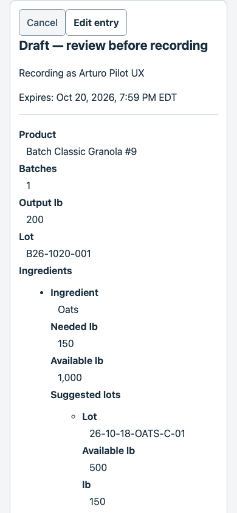
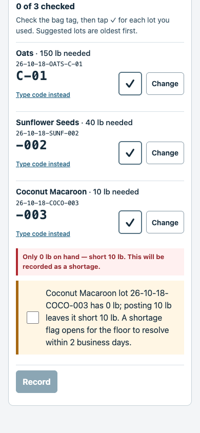
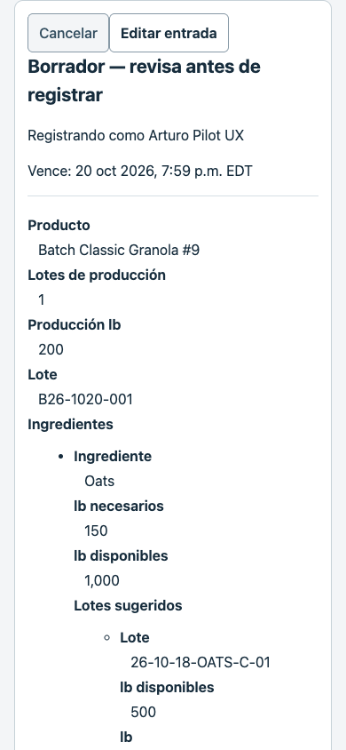
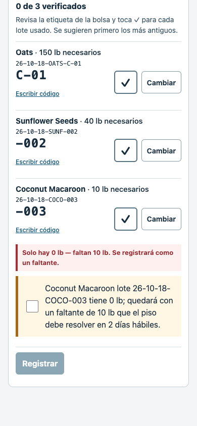

# Make draft: easier to check on a phone

[Draft PR #144](https://github.com/sevenwells72/factory-ledger/pull/144) is open and unmerged.

The Make draft now gives each ingredient one compact row. It shows the needed pounds, the full suggested lot code with its last characters enlarged, a ✓ button and Change. Nothing is checked automatically. The form explains that the ingredients come from the product’s recipe and appear after Prepare.

Arturo can check the bag tag and tap ✓. If he used another lot, Change shows its full code, received date and pounds on hand. He selects it and checks its tag. He can still type the last four characters or full code, or use the barcode-reader input. Lots that both end in C-01 are easy to distinguish by their complete codes.

Record stays disabled until every ingredient is checked, and the draft shows how many are done. Changing a lot clears that ingredient’s checks. A failed refresh cannot record an older lot choice. A red warning keeps a shortage visible; the existing shortage acknowledgement and recording rules still apply. Substitutions and Choose a different ingredient lot still work.

Receipts and the permanent lot history say whether each lot was confirmed by tapping, typing or scanning. Tapping is stored as tapping; it is never relabelled as typed or scanned evidence.

The same three-ingredient test draft is about 74% shorter: 4,349 to 1,138 pixels in English and 4,380 to 1,146 in Spanish. All ingredient rows, the red warning and Record fit together in one 390 × 844 ingredient view. The batch header and other details remain scrollable.

| 390px phone | Before | After: ingredient checks |
|---|---|---|
| English |  |  |
| Spanish |  |  |

The same top-of-draft comparison is also available in [English](screenshots/after-en-390-make-draft.png) and [Spanish](screenshots/after-es-390-make-draft.png). See the complete before drafts in [English](screenshots/before-en-390-make-draft-full.png) and [Spanish](screenshots/before-es-390-make-draft-full.png), the [English lot choices](screenshots/after-en-390-change-lot.png), [Spanish lot choices](screenshots/after-es-390-change-lot.png), and the receipt’s [English](screenshots/after-en-390-receipt-confirmation-method.png) / [Spanish](screenshots/after-es-390-receipt-confirmation-method.png) confirmation labels.

Choices made to finish the work:

- Keep the existing oldest-first suggestion, with no automatic confirmation. Keep full codes visible because the enlarged endings can repeat.
- Show six alternate lots at a time, with More lots for the rest. If an ingredient needs more than one lot, keep them in the same row and require a separate check for each.
- Show an unknown received date as unavailable instead of inventing one from when the record was created.
- Use disposable local stock and a clearly synthetic Classic Granola #9 recipe: 150 lb oats, 40 lb sunflower seeds and 10 lb coconut in a 200 lb batch. This demonstrates the phone problem without reading live recipes or balances.
- Test the barcode-reader path with simulated scanner input. No physical scanner or physical phone was used; phone layouts were checked in the browser at 390px.

The full Python suite passed 6,935 checks with sessions off and 6,935 with sessions on, using a fresh local database for each. All 577 Node checks passed. The dedicated Make walkthrough passed all 48 checks in English and Spanish at 390px and desktop width, recording eight local receipts and comparing their confirmation methods with the permanent history. It covers every tap, changing a lot, colliding C-01 endings, shortages, blocked Record, substitutions and typed/scanned evidence.

The current functional browser runners also pass in their documented modes. Earlier failed attempts are retained: one older migration check and scripts for the previous Make layout needed updating, and reusing a test database polluted a first test run. Fresh independent runs pass. An extra Chromium check of the unchanged Assistant photo-upload retry still fails; the same check fails on untouched main, while the runner’s default WebKit suite passes. The wider dashboard layout audit finished 388 captures and lists 402 checks needing attention and 63 warnings, with no rendering errors. It covers other screens and is not presented as a clean Make result. Hosted, real-model and superseded historical runners were excluded as listed in the detailed report.

See the [full test report](FULL_SUITE_REPORT.md), [Make walkthrough](BROWSER_WALKTHROUGH.md), [machine-readable results](verification.json), and [protected-file checks](scope-guard.json).

Zero OpenAI API calls were made. No staging or production database or Railway action was used. main.py, pool code, Assistant turn handling and dashboard/fl-assistant files are unchanged. The new database update for storing tap confirmations is included as migration 085, but has only been applied to disposable local test databases. It must be applied separately before a future hosted release. This work is for an unmerged Draft PR. No production deployment was run. Opening the PR automatically created a Netlify preview; it was not used to contact a live database.
