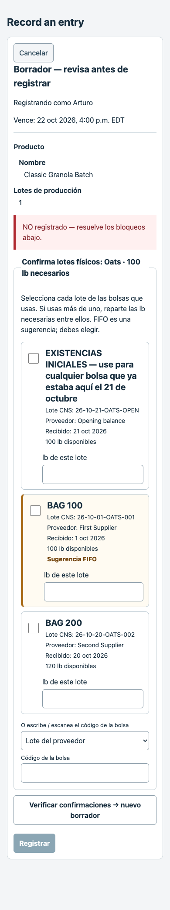

# Supplier-lot choices for Make and Pack

This is the original submission report. See [the combined-branch review fixes](review-fixes/README.md) for the current stock rule, rollout switch and validation.

CNS codes are not printed on supplier bags. Workers can now choose the supplier lot they are holding, or type its code, for every Make/Pack ingredient. The list shows the supplier code, CNS code, supplier, received date and available pounds. Opening Stock is first; ordinary lots follow oldest first. FIFO is highlighted and never selected automatically.

Multiple supplier codes on a commingled CNS lot remain searchable and visible. An ambiguous code requires an explicit lot choice. An unknown code keeps the stock list visible and explains in English and Spanish when to choose Opening Stock for bags already here on October 21. Two or more chosen lots must add up to the ingredient requirement; the server checks the actual identities and pounds again.

The same checks run in Today, FL Assistant and the existing Floor Make/Pack operations. The Floor schema remains at 22 operations; generated instructions are 7,688 characters including their header. Last-four, full CNS code, scan and recent pallet-move evidence remain available. Signed ticket identity, human-only physical choices, extra-kosher holds, unresolved Different lot follow-up, shortage exceptions and pre-make adjustment checks are retained. Substitution audits now identify every actual selected lot and its pounds.

## Deployment and compatibility

This branch starts from origin/main at 27a25186. No merge, production database access, Railway access or hosted deployment was performed. The production freeze remains active. Commit and PR title include `[skip netlify]` to suppress automatic Netlify deployment.

Migration `087_supplier_lot_confirmation.sql` is an explicit future rollout prerequisite, after 062 and 063. It adds the supplier confirmation method without removing any existing methods (including the tap method reserved by PR #144), and retains exact split substitution evidence. It has only been applied to disposable local PostgreSQL databases. Migration numbers 085 and 086 and regression rows 225–230 remain reserved by other open PRs.

The updated Floor schema requires both physical-evidence arrays on every Make/Pack call, even the initial preview. Older direct API consumers that omit both fields retain their existing legacy behavior; the ticket, Today, Assistant and updated Floor flows require explicit evidence. No hosted GPT editor was changed.

## Validation

| Check | Result |
|---|---|
| Full Python, sessions off, fresh PG17 | 6,955 passed; zero failures/skips |
| Full Python, sessions on, separate fresh PG17 | 6,954 passed; zero failures; one advisory-lock guard skipped |
| Sessions-on advisory-lock module, rerun alone | All 16 passed; zero failures/skips |
| Full JavaScript | 600 passed; zero failures/skips |
| Floor schema / instructions | 22 → 22 operations; 7,688 characters |
| Office schema | 30 → 30 operations, unchanged |
| Key literal guard / whitespace | Zero findings / clean |

All Python cases were exercised successfully. The sessions-on guard checks advisory locks across the local server and deliberately skipped while the other full suite was running; its complete module then passed alone. Application and test source hashes remained unchanged during the final runs. Compressed logs, `verification.json` and `tested-source-sha256.json` retain the evidence.

Exploratory logs are retained: their failures were stale instruction expectations and in-progress Pack tests, plus one fixture migration deadlock caused by concurrent runs sharing a test database. Final runs use separate fresh databases.

The Chrome phone checks use local synthetic fixtures with all nonlocal requests blocked. Both languages verified no initial selection, disabled Record before evidence, no horizontal overflow or page errors, and an exact 40 + 60 lb split. HTTP tests separately exercise the actual API and PostgreSQL; the screenshot recipe is synthetic and is not live inventory.

All three named disposable test databases were dropped after validation; no matching task scratch databases remained. The shared PostgreSQL service was left running.
