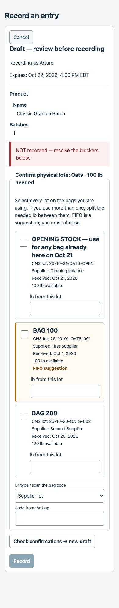

# PR147 review fixes on the combined receive / signed-slip branch

This revision addresses [review 6349465333](https://github.com/sevenwells72/factory-ledger/pull/147#issuecomment-6349465333) and the owner's conditional over-draw decision. The branch is rebased onto PR146 at `282204be`, which includes PR145 at `ffc405e8`.

## Stock rule

When the ingredient has enough usable stock overall, a worker cannot put more pounds on a chosen lot than that lot has. The server refuses in English and Spanish and asks the worker to choose the right lot or split the pounds. It checks at prepare and again at commit after locking the relevant lots, including frozen input plans. When total usable stock is genuinely short, the existing post-and-flag policy remains. Today and Assistant show the same conditional quantity limits; Floor uses the same server validator.

Kosher-ineligible source lots cannot make an extra-kosher Pack look sufficiently stocked. Missing supplier identities such as `UNKNOWN` are displayed as missing, not offered as real supplier codes; meaningful commingled aliases remain usable.

## Combined Floor contract

- Schema **4.4.0**, **22 operations**; every description is at most 300 characters.
- Generated instructions: **7,987 characters including header**, **7,857 body characters**. All ten permanent rules and the ledger-view guard remain.
- The exact PR145 no-lot / unreadable-lot rule uses `no_supplier_lot: true` and an empty supplier code; it never substitutes UNKNOWN or N/A. The redundant RECEIVE pre-flight sentence is trimmed to “Search first per shared rules.”
- PR146's signed `packing_slip_url` rule and server behavior remain intact. No key is inserted into a packing-slip link.
- Shared cache versions are above PR145: `ledger-forms.css` 10, `ledger-ticket.js` 11, `fl-assistant.css` 10 and `fl-assistant.js` 18. Upstream receive assets and tests are preserved.

## Future rollout prerequisites — nothing executed here

The production freeze remains active. No merge, deploy, production write or Railway setting change is authorized by this work.

**Migration 087 must be explicitly applied before the PR147 application deployment**, after migrations 062 and 063. Both supplier-lot confirmation inserts and substitution/exclusion audit inserts depend on it.

The server switch `REQUIRE_MAKE_PACK_LOT_EVIDENCE` defaults **OFF**. Leave it OFF until the combined Floor GPT schema and instructions have been pasted and checked in a separately approved rollout. Once enabled, legacy `/make` and `/pack` commits must supply both non-null evidence arrays; empty arrays cannot confirm FIFO. Previews use the checked selection flow. The master key cannot identify Floor separately from older integrations, so enabling this switch applies to all callers of those two legacy routes.

## Final validation

| Check | Result |
|---|---|
| Full Python, sessions OFF, fresh private PG17 | **7,186 passed**, zero failures/errors/skips |
| Full Python, sessions ON, separate fresh private PG17 | **7,186 passed**, zero failures/errors/skips |
| Full JavaScript | **640 passed**, zero failures/skips |
| Schema, instruction and cache contracts | Pass; exact budgets and versions above |
| Key-literal guard / whitespace | Zero findings / clean |
| Frozen application/test/contract sources | All **404 hashes unchanged** during the full suites |

Both full Python suites ran sequentially in a private local PostgreSQL17 cluster. Compressed complete logs, source hashes and `verification.json` are included. Coverage includes covered-stock over-draw refusals, real shortage posting on every client path, frozen-plan revalidation, tier-eligible totals, flag OFF/ON/missing/null behavior, upstream receive and signed-slip contracts, and the deterministic substitution lock-order regression.

All four named test databases were removed, as were any task scratch databases. The private cluster was stopped and its temporary data removed; the shared local PostgreSQL service was left running. `cleanup.json` records the cleanup. All testing uses local databases and local browser fixtures. No production or Railway access, merge, main push or deploy occurred. The protected count worktree and `audits/fresh-start/` are untouched.

## Phone checks

The final combined card passed local-only Chrome fixtures at 390 px in English and Spanish: no initial lot selection, Record disabled before reviewed evidence, no horizontal overflow or page errors, and exact 40 + 60 lb allocation. These screenshots use a synthetic recipe and inventory.

